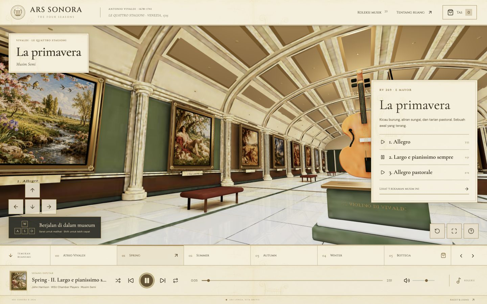

# Vivaldi Gallery · The Four Seasons

[English](README.md) | **Bahasa Indonesia**

[](https://github.com/mhpbuild/Vivaldi-Gallery/actions/workflows/ci.yml)
[](LICENSE)
[](ASSET_LICENSES.md)

Galeri musik 3D untuk menikmati **Antonio Vivaldi — The Four Seasons**. Dibangun dengan React, Three.js, TypeScript, dan Blender: empat galeri musim, 20 rekaman, sekitar 98 menit musik, dan toko suvenir simulasi.

## Dari programmer yang cinta Vivaldi

> Proyek ini dibuat oleh seorang programmer yang mencintai musik Vivaldi, sebagai eksperimen pribadi di waktu luang. Tidak ada niat menjatuhkan, meremehkan, menyindir, menyerang, atau merugikan pihak mana pun. Murni proyek gabut yang damai untuk belajar, bereksperimen, dan berbagi apresiasi musik. **Peace ✌🏻**
>
> Ini proyek penggemar yang independen. Tidak mewakili, berafiliasi dengan, disponsori, atau disahkan oleh musisi, pemegang hak, institusi, perusahaan, maupun situs sumber yang disebutkan. Semua kredit tetap milik penciptanya. Toko dan transaksi di dalam galeri sepenuhnya simulasi.



## Yang bisa dicoba

- Museum virtual 22 × 64 meter (1.408 m²), empat ruang musim, 12 lukisan gerakan, dan empat meja interpretasi.
- Klik lukisan untuk memutar musik. Cari, filter per musim, atau unduh rekaman beserta rujukan lisensinya.
- Jelajah dengan WASD/panah, tahan Shift untuk lebih cepat, seret untuk melihat; tersedia tombol arah di ponsel.
- Pemutar dengan seek, volume, shuffle, repeat, serta pilihan file musik pribadi yang diputar lokal.
- Toko suvenir, keranjang, dan checkout demo tanpa uang, data pembayaran, atau pengiriman nyata.
- Model Blender yang bisa diedit, GLB untuk web, serta layout dan katalog dalam JSON.

## Jalankan sendiri

Gunakan **Node.js 24** (atau 22.18+) dan npm. Git LFS tidak diperlukan. Clone cukup besar karena memuat rekaman dan model Blender.

```sh
git clone --depth 1 https://github.com/mhpbuild/Vivaldi-Gallery.git
cd Vivaldi-Gallery
npm ci
npm run dev
```

Buka <http://127.0.0.1:5174/>. Perlu browser dengan WebGL. Repositori public ini menyediakan kode dan aset; publikasi repositori tidak otomatis membuat website live.

```sh
npm run lint
npm run typecheck
npm test
npm run build
```

Hasil build ada di `dist/`. Untuk hosting pada subfolder, sesuaikan konfigurasi base URL dan jalur aset terlebih dahulu. Model web sekitar 18 MiB, sehingga pemuatan awal bergantung pada koneksi; audio tidak diunduh seluruhnya saat membuka halaman.

## Lisensi: kode dan media berbeda

**MIT berlaku untuk kode, bukan otomatis untuk seluruh musik dan gambar.**

| Bagian | Lisensi / status |
| --- | --- |
| Kode aplikasi, skrip Blender, pengujian, dan dokumentasi asli | [MIT](LICENSE), © 2026 mhpbuild |
| Rekaman 01–12, John Harrison / Robert Turizziani / WSU Chamber Players | [CC BY-SA 4.0](licenses/CC-BY-SA-4.0.txt) |
| Rekaman 13–20, Gregor Quendel | [CC BY-NC 4.0](licenses/CC-BY-NC-4.0.txt), **hanya nonkomersial** |
| Model, tekstur prosedural, dan ilustrasi asli proyek | [CC BY 4.0](licenses/CC-BY-4.0.txt), sebatas hak yang dimiliki kontributor |
| Dua potret historis Vivaldi | Domain publik, dengan sumber di [CREDITS.md](CREDITS.md) |

Rekaman berasal dari [Classicals.de](https://www.classicals.de/vivaldi-seasons), digunakan utuh tanpa penyuntingan. Lisensi kode MIT tidak memberikan izin komersial atas delapan rekaman CC BY-NC. Untuk penggunaan komersial, ganti rekaman tersebut atau dapatkan izin yang sesuai dari pemegang hak. Komposisi yang tua tidak otomatis membuat rekaman modern menjadi domain publik.

Baca [rincian lisensi aset](ASSET_LICENSES.md), [kredit setiap rekaman](CREDITS.md), dan [pemberitahuan pihak ketiga](THIRD_PARTY_NOTICES.md) sebelum mendistribusikan ulang. Ilustrasi musim dibuat dengan bantuan AI; bukan karya historis Vivaldi atau pelukis lama. Model instrumen merupakan interpretasi, bukan pemindaian instrumen autentik.

## Struktur dan Blender

| Lokasi | Isi |
| --- | --- |
| `src/` | Antarmuka, navigasi, pemutar, katalog, dan layout |
| `public/audio/vivaldi/` | 20 MP3, kredit, dan checksum SHA-256 |
| `public/art/` | Ilustrasi musim, potret, dan tekstur kertas |
| `public/models/vivaldi-four-seasons.glb` | Model siap pakai untuk web |
| `blender/` | Master, versi baked, skrip pembuatan, dan render |
| `tests/` | Pengujian katalog, kapasitas, navigasi, dan keranjang |

Master: `blender/Vivaldi-Four-Seasons-Museum.blend`. Versi baked: `blender/Vivaldi-Four-Seasons-Web.blend`. Gunakan Blender 5.2+ untuk membangun ulang:

```sh
blender --background --factory-startup --python blender/build_vivaldi.py -- --render-preview
blender --background --factory-startup --python blender/bake_vivaldi.py
blender --background --factory-startup --python blender/denoise_vivaldi.py
```

Di macOS, ganti `blender` dengan executable di dalam aplikasi Blender bila belum tersedia di PATH. `build_museum.py` dipertahankan sebagai utilitas geometri yang dipakai builder Vivaldi; hasil percobaan museum lama tidak termasuk versi aktif. Gambar model sudah packed. File font sistem tidak didistribusikan; builder memakai font sistem yang tersedia atau font bawaan Blender. Render Cycles dan tampilan browser memakai pipeline yang berbeda.

## Privasi, kontribusi, dan pemeliharaan

File musik pribadi dimainkan melalui object URL di browser dan tidak diunggah. Keranjang demo tersimpan di localStorage. Google Fonts dimuat dari layanan eksternal. Tidak ada backend pembayaran.

Silakan buka issue atau pull request sesuai [CONTRIBUTING.md](CONTRIBUTING.md). Jaga suasana sesuai [CODE_OF_CONDUCT.md](CODE_OF_CONDUCT.md). Untuk kerentanan, baca [SECURITY.md](SECURITY.md). Ini proyek hobi yang disediakan apa adanya, tanpa jaminan dukungan atau ketepatan sejarah.

Pengembangan berikutnya menggunakan commit dan **push biasa** ke `main`, atau branch dan pull request. Tidak memakai `git push --mirror`. Riwayat awal tetap dipertahankan; kredit aset percobaan yang masih dapat ditemukan di riwayat tersedia di [THIRD_PARTY_NOTICES.md](THIRD_PARTY_NOTICES.md).
