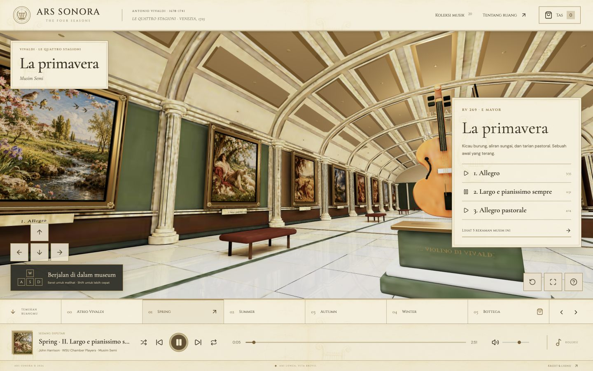

# Vivaldi Gallery · The Four Seasons

**English** | [Bahasa Indonesia](README.id.md)

[](https://github.com/mhpbuild/Vivaldi-Gallery/actions/workflows/ci.yml)
[](LICENSE)
[](ASSET_LICENSES.md)

A 3D music gallery for enjoying **Antonio Vivaldi — The Four Seasons**. Built with React, Three.js, TypeScript and Blender: four seasonal galleries, 20 recordings, approximately 98 minutes of music, and a simulated souvenir shop.

## From a programmer who loves Vivaldi

> This project was made by a programmer who loves Vivaldi's music, as a personal experiment in their spare time. There is no intention to disparage, belittle, mock, attack or harm anyone. It is simply a peaceful hobby project for learning, experimenting and sharing an appreciation of music. **Peace ✌🏻**
>
> This is an independent fan project. It does not represent, have an affiliation with, receive sponsorship from, or carry the endorsement of any musician, rights holder, institution, company or source website mentioned here. All credit remains with the respective creators. The shop and every transaction in the gallery are entirely simulated.



## What you can explore

- A 22 × 64 metre virtual museum (1,408 m²), with four seasonal rooms, 12 movement paintings and four interpretation desks.
- Click a painting to play its movement. Search, filter by season, or download recordings with their license references.
- Walk with WASD or arrow keys, hold Shift to move faster and drag to look around; on-screen direction controls are available on phones.
- A player with seeking, volume, shuffle, repeat and locally played personal music files.
- A souvenir shop, cart and demo checkout without real money, payment details or physical deliveries.
- Editable Blender scenes, a web GLB, and the layout and catalogue in JSON.

## Run locally

Use **Node.js 24** (or 22.18+) and npm. Git LFS is not required. The clone is fairly large because it includes recordings and Blender scenes.

```sh
git clone --depth 1 https://github.com/mhpbuild/Vivaldi-Gallery.git
cd Vivaldi-Gallery
npm ci
npm run dev
```

Open <http://127.0.0.1:5174/> in a browser with WebGL support. This public repository provides the code and assets; publishing the repository does not automatically deploy a live website.

```sh
npm run lint
npm run typecheck
npm test
npm run build
```

The build output is in `dist/`. For hosting in a subdirectory, adjust the base URL configuration and asset paths first. The web model is approximately 18 MiB, so initial loading depends on the connection; the entire audio catalogue is not downloaded when the page opens.

## Licensing: code and media have different terms

**MIT covers the code; it does not automatically cover all music and images.**

| Component | License / status |
| --- | --- |
| Original application code, Blender scripts, tests and documentation | [MIT](LICENSE), © 2026 mhpbuild |
| Recordings 01–12, John Harrison / Robert Turizziani / WSU Chamber Players | [CC BY-SA 4.0](licenses/CC-BY-SA-4.0.txt) |
| Recordings 13–20, Gregor Quendel | [CC BY-NC 4.0](licenses/CC-BY-NC-4.0.txt), **noncommercial use only** |
| Original project models, procedural textures and illustrations | [CC BY 4.0](licenses/CC-BY-4.0.txt), to the extent contributors hold the rights |
| Two historical Vivaldi portraits | Public domain, with sources in [CREDITS.md](CREDITS.md) |

The recordings come from [Classicals.de](https://www.classicals.de/vivaldi-seasons) and are used in full, without editing. The code's MIT license does not grant commercial permission for the eight CC BY-NC recordings. For commercial use, replace those recordings or obtain appropriate permission from their rights holders. An old composition does not automatically make a modern recording public domain.

Read the [asset license details](ASSET_LICENSES.md), [individual recording credits](CREDITS.md) and [third-party notices](THIRD_PARTY_NOTICES.md) before redistribution. The seasonal illustrations were made with AI assistance; they are not historical works by Vivaldi or an old master. The instrument model is an interpretation, not a scan of an authenticated instrument.

## Project structure and Blender

| Location | Contents |
| --- | --- |
| `src/` | Interface, navigation, player, catalogue and layout |
| `public/audio/vivaldi/` | 20 MP3 files, credits and SHA-256 checksums |
| `public/art/` | Seasonal illustrations, portraits and parchment texture |
| `public/models/vivaldi-four-seasons.glb` | Web-ready model |
| `blender/` | Master and baked scenes, build scripts and render |
| `tests/` | Catalogue, capacity, navigation and cart tests |

Master scene: `blender/Vivaldi-Four-Seasons-Museum.blend`. Baked scene: `blender/Vivaldi-Four-Seasons-Web.blend`. Rebuild using Blender 5.2+:

```sh
blender --background --factory-startup --python blender/build_vivaldi.py -- --render-preview
blender --background --factory-startup --python blender/bake_vivaldi.py
blender --background --factory-startup --python blender/denoise_vivaldi.py
```

On macOS, replace `blender` with the executable inside the Blender application if it is not on PATH. `build_museum.py` is retained for the geometry utilities used by the Vivaldi builder; old museum experiment outputs are not part of the active version. Model images are packed. System font files are not distributed; the builder uses an available system font or Blender's built-in font. Cycles renders and the browser view use different rendering pipelines.

## Privacy, contributions and maintenance

Personal music files are played through browser object URLs and are not uploaded. The demo cart is stored in localStorage. Google Fonts are loaded from an external service. There is no payment backend.

Please open issues or pull requests following [CONTRIBUTING.md](CONTRIBUTING.md). Keep interactions respectful under [CODE_OF_CONDUCT.md](CODE_OF_CONDUCT.md). For vulnerabilities, read [SECURITY.md](SECURITY.md). This hobby project is provided as-is, without guaranteed support or historical accuracy.

Further development uses commits and **normal pushes** to `main`, or branches and pull requests. It does not use `git push --mirror`. The initial history is retained; credits for experimental assets still available in history are preserved in [THIRD_PARTY_NOTICES.md](THIRD_PARTY_NOTICES.md).
